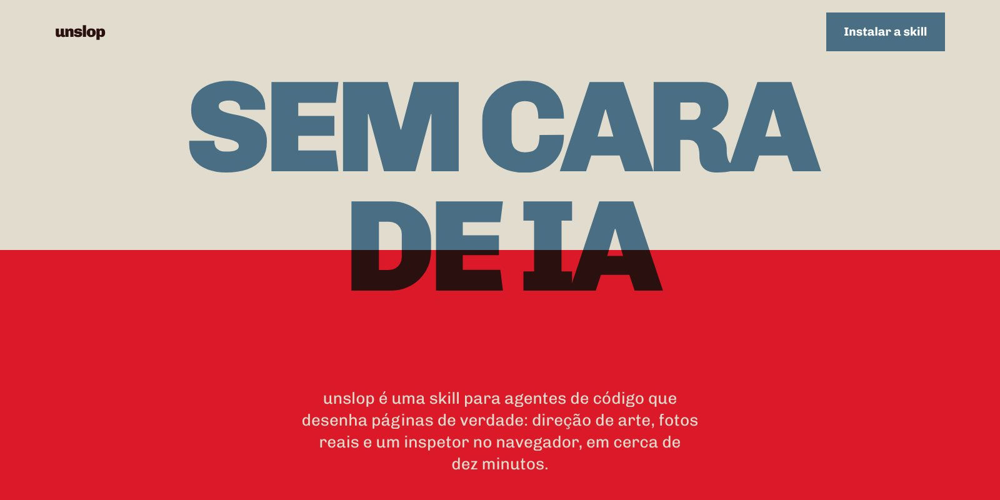
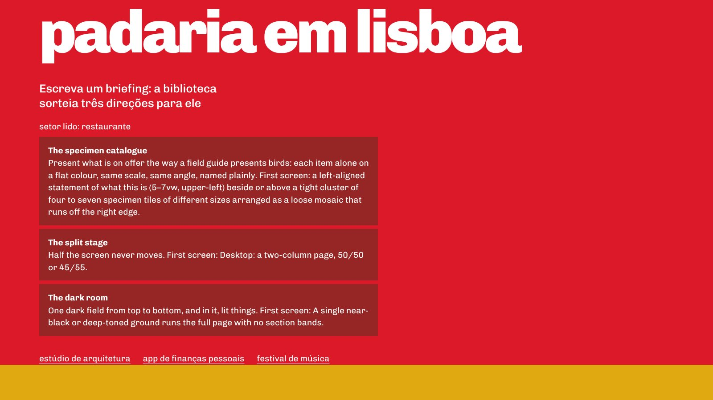
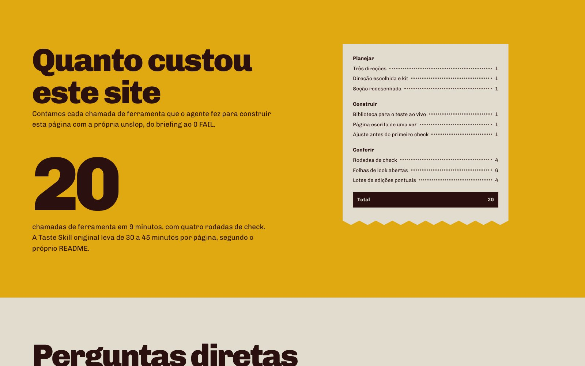
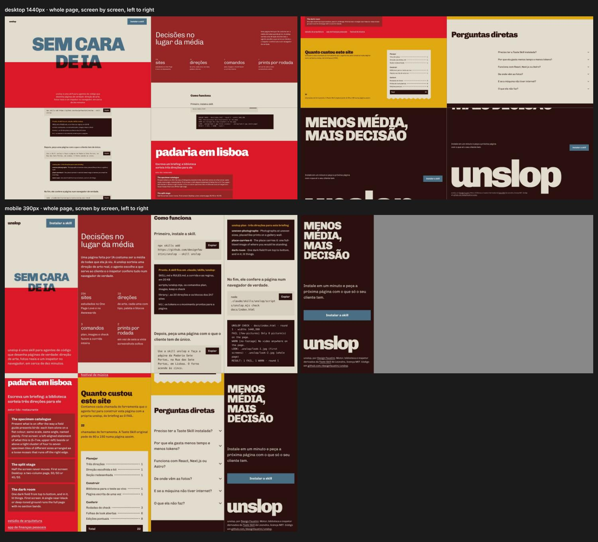
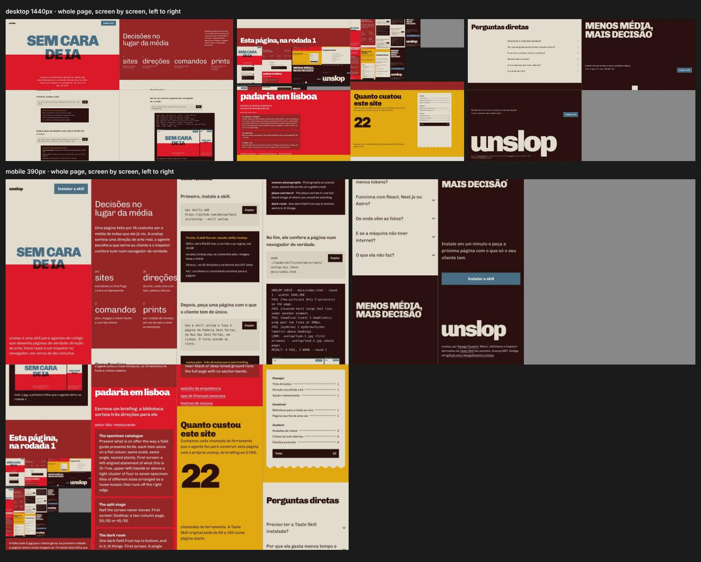

<p align="center">
  <a href="https://designfaustini.github.io/unslop/" title="Abrir o site da unslop">
    
  </a>
</p>

<p align="center">
  <a href="https://designfaustini.github.io/unslop/"></a>
  &nbsp;
  <a href="LICENSE"></a>
  &nbsp;
  
</p>

# unslop

**Sites sem cara de IA, em minutos.** unslop é uma skill para agentes de código (Claude Code, Codex, Cursor e afins) que dá direção de arte, fotos reais e um inspetor no navegador para qualquer landing page, site institucional, portfólio ou página de produto.

É uma versão otimizada da [Taste Skill](https://github.com/Leonxlnx/taste-skill) de Leonxlnx. Mesma biblioteca de 247 sites premiados, mesmo inspetor rigoroso, só que com um fluxo pensado para gastar muito menos tempo e tokens.

> O site acima foi construído pela própria unslop, do briefing ao 0 FAIL, em **9 minutos e 20 chamadas de ferramenta**. A Taste Skill original declara de 30 a 45 minutos e algumas centenas de milhares de tokens por página.

## O problema

Página feita por IA costuma ser a média de todas as páginas que o modelo já viu:

- título centralizado com uma etiquetinha em cima
- três cards com ícone
- degradê suave, sombras, linhas finas, legenda em fonte monoespaçada

A Taste Skill resolve isso muito bem: sorteia uma direção de arte real, busca fotos em acervos abertos, abre a página num navegador, tira print e corrige os piores erros, até três vezes. O preço é alto: o agente lê quase 200 KB de instruções, abre dezenas de screenshots e escreve tudo do zero, inclusive a camada de animação.

## O que a unslop muda

| Etapa | Taste Skill v2 | unslop |
| --- | --- | --- |
| Instruções que o agente lê | SKILL.md + 7 referências: **199 KB** | SKILL.md + RULES.md: **20,7 KB** |
| Ficha da direção de arte | 24 KB (com sites de referência e lista de fotos) | card de 11 KB, só o que vira layout |
| Busca de fotos | uma consulta por vez, lista em texto, abre imagem por imagem | várias consultas em paralelo, **uma folha de contato numerada** |
| Tokens de design e animação | escritos à mão a cada página | `unslop.css` e `unslop.js` gerados pelo plano, animação por atributo |
| Prints por rodada de revisão | todos os screenshots do inspetor (10 nesta página) | **2 folhas compostas** (primeiras telas + página inteira) |
| Saída do inspetor | relatório longo com instruções repetidas | FAIL com a correção, WARN em uma linha |
| Correções | sem regra de escrita | página escrita uma vez, correções com edições pontuais |
| Tempo por página | 30 a 45 min (README da Taste Skill) | **9 min** medidos no site deste repositório |

Por que isso importa: cada imagem aberta custa cerca de 1.500 tokens e fica no contexto até o fim da sessão, sendo reenviada a cada nova chamada. Abrir 2 folhas por rodada em vez de 10 screenshots corta cerca de 12 mil tokens por rodada só ali, e o corte se multiplica a cada chamada seguinte.

## Habilidades

- **Direção de arte sorteada, não inventada.** O script entrega três de 20 direções pesquisadas; o agente escolhe a que carrega algo que só aquele cliente tem. Depois vem o card com hero, blocos de seção, tipografia, paleta e movimento.
- **Kit pronto a cada plano.** Os tokens sorteados (cores, fontes, escala de tipo) viram `unslop.css`; o movimento (entradas escalonadas, hover, título que sobe da linha de base, cortina, galeria lateral, números que rolam) é ligado por atributos como `data-move="masked"`.
- **Fotos reais com crédito.** Busca em Openverse, Wikimedia Commons, Art Institute of Chicago e Met, só com licenças de uso comercial. Baixa em tamanho cheio, guarda título, autor e licença, e gera a linha de crédito do rodapé.
- **Inspetor num navegador de verdade.** Mede em 1440, 768 e 390 px: títulos com mais de duas linhas, etiquetas acima de título, monoespaçada, numeração 01/02/03, linhas finas, degradês, sombras, paleta de assistente, margens desiguais, telas vazias, texto coberto, falta de fotos, página parada.
- **Crítica em quatro linhas.** Rubrica no peso do Awwwards (design 40%, usabilidade 30%, criatividade 20%, conteúdo 10%) com tetos automáticos. Para na rodada em que não há FAIL nem nota abaixo de 7, ou na terceira.
- **Honestidade embutida.** Nada de depoimentos, clientes, números ou logos inventados. Foto de acervo nunca é apresentada como produto do cliente.
- **Redesign e revisão.** `check` funciona em qualquer arquivo ou URL local, então dá para medir um site existente antes de mexer.

## Instalação

Precisa de **Node 22+** e de um Chrome, Edge ou Chromium instalado (o Chromium do Playwright é encontrado sozinho). Não instala dependências e não usa chave de API. A busca de fotos precisa de internet.

**Com o CLI `skills` (Claude Code, Codex, Cursor e outros):**

```bash
npx skills add https://github.com/designfaustini/unslop --skill unslop
```

**Como plugin do Claude Code:**

```
/plugin marketplace add designfaustini/unslop
/plugin install unslop@unslop
```

**A partir de um clone, com link simbólico (um `git pull` atualiza tudo):**

```bash
git clone https://github.com/designfaustini/unslop
cd unslop && ./install.sh            # Claude Code (~/.claude/skills/unslop)
./install.sh --codex                 # Codex
```

## Como usar

Peça a página ao agente com o que o cliente tem de único. A skill dispara sozinha quando o assunto é criar, refazer ou melhorar uma página, ou quando alguém diz que o site está com "cara de IA".

```text
Use a skill unslop e faça a página da Padaria Sete Portas, na Rua das Sete Portas, em Lisboa.
O forno acende às cinco. Quero cardápio com preços e um jeito de encomendar o pão do dia seguinte.
```

Por baixo, a corrida inteira cabe em poucos comandos:

```bash
U="node .claude/skills/unslop/scripts/unslop.mjs"

$U plan --sector restaurant --brief "padaria em Lisboa, forno às cinco" --sections intro,menu,gallery,contact
$U plan <mesmos argumentos> --direction place-carries-it --site site     # card + unslop.css + unslop.js
$U images "lisbon postcard" "lisbon old map" "bread oven engraving" "azulejo"
$U keep 2,5,7,9 --to site/assets/img
$U check site/index.html                                                 # lint + inspetor + 2 folhas
$U check site/index.html --final
```

## O site, feito com a própria skill

A página em [`docs/`](docs/) foi construída do jeito que a skill manda, com a corrida cronometrada:

- direção sorteada: **Type and nothing else** (seed 1462100546), escolhida porque uma ferramenta de linha de comando não tem foto de produto; as imagens dela são os prints da própria construção
- uma seção redesenhada, com motivo: o bloco de introdução pedia um parágrafo gigante, o que fere a regra de que texto corrido grande vira título
- ideia: a própria corrida da skill (plan, check, as folhas de look) vira as peças tipográficas da página
- coisa viva: digite um briefing e a biblioteca sorteia três direções para ele, ali mesmo
- resultado: 4 FAIL na rodada 1, 0 FAIL na rodada 2, 0 FAIL nas três larguras no check final

<table>
  <tr>
    <td width="50%"></td>
    <td width="50%"></td>
  </tr>
  <tr>
    <td width="50%"></td>
    <td width="50%"></td>
  </tr>
</table>

Para publicar: **Settings → Pages → Deploy from a branch → `main` / `docs`**. O endereço fica `https://designfaustini.github.io/unslop/`.

### Sobre as medições

- **Medido:** 9 minutos e 20 chamadas de ferramenta do primeiro `plan` ao check final com 0 FAIL; tamanho dos arquivos de instrução e das fichas; número de screenshots por rodada.
- **Fora da conta:** as correções que fiz na própria skill durante esse primeiro uso real (dois bugs no card, a busca automática pelo Chromium do Playwright, o suporte a cópias decorativas de título) e um ajuste de CSS no recibo depois do check final, conferido com mais um check.
- **Não medido aqui:** tokens exatos e um build da Taste Skill original lado a lado. Os 30 a 45 minutos vêm do README dela. A rede deste ambiente bloqueava os acervos de imagens, então a busca foi testada com uma fonte simulada e este site usa como fotos os prints reais da própria construção.

## Estrutura

```
skills/unslop/
  SKILL.md            a corrida enxuta e o orçamento de chamadas
  RULES.md            regras da casa, leis do ofício, palavras e a crítica em 4 linhas
  scripts/unslop.mjs  plan · images · keep · credits · check
  kit/                unslop.css (base neutra) e unslop.js (movimento por atributo)
  engine/             motor da Taste Skill: sorteio, busca de imagens, lint, inspetor (MIT)
  library/            20 direções, heróis, seções, tipos, paletas e os 247 sites estudados
docs/                 o site da unslop, feito com a unslop
assets/               banner e prints do README
```

## Créditos e licença

MIT. O motor (`skills/unslop/engine/`) e a biblioteca (`skills/unslop/library/`) vêm da [Taste Skill](https://github.com/Leonxlnx/taste-skill) de Leonxlnx, também MIT, com pequenas mudanças: rodar como root com `--no-sandbox`, achar o Chromium do Playwright, ignorar a pasta `.unslop`. O fluxo, o CLI, o kit, as regras compactas e o site são da [Design Faustini](https://github.com/designfaustini). Detalhes em [LICENSE](LICENSE).
