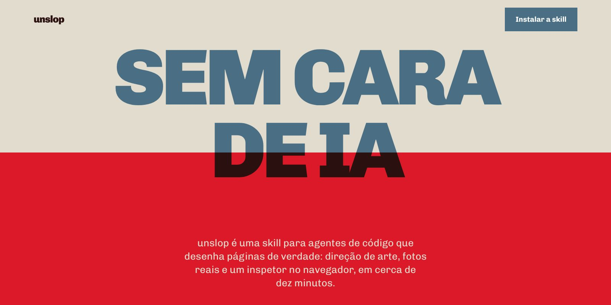
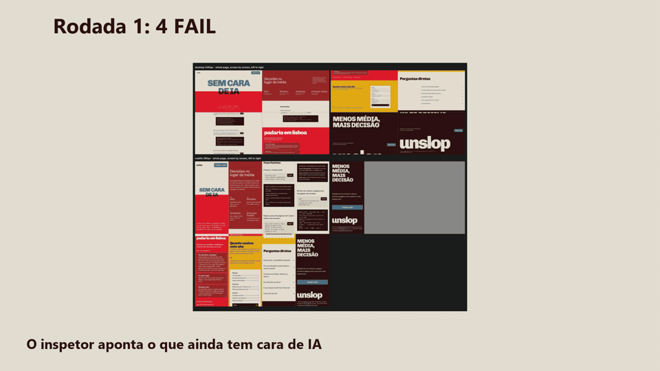

<p align="center">
  <a href="https://designfaustini.github.io/unslop/" title="Open the unslop site">
    
  </a>
</p>

<p align="center">
  <a href="https://designfaustini.github.io/unslop/"></a>
  &nbsp;
  <a href="LICENSE"></a>
  &nbsp;
  
</p>

# unslop

🇬🇧 English · 🇧🇷 [Português](README.pt-BR.md)

**Websites that don't look AI-made, in minutes.** unslop is a skill for coding agents (Claude Code, Codex, Cursor and friends) that gives any landing page, company site, portfolio or product page real art direction, real photos and a real-browser inspector.

<p align="center"></p>

It is a leaner version of Leonxlnx's [Taste Skill](https://github.com/Leonxlnx/taste-skill): the same library of 247 award-winning sites and the same strict inspector, with a workflow built to spend far less time and fewer tokens.

> The site linked above was built by unslop itself, from brief to 0 FAIL, in **9 minutes and 20 tool calls** (a single measured run, see [Measurements](#measurements)). Taste Skill's own README states 30 to 45 minutes per page.

## The problem

A page written by an AI tends to be the average of every page the model has seen:

- a centered headline with a tiny pill above it
- three cards with icons
- a soft gradient, shadows, hairlines, monospace captions

Taste Skill fixes this well: it draws a real art direction, fetches photos from open archives, opens the page in a browser, takes screenshots and fixes the worst problems, up to three times. The price is high: the agent reads almost 200 KB of instructions, opens dozens of screenshots and writes everything from scratch, motion layer included.

## What unslop changes

| Step | Taste Skill v2 | unslop |
|---|---|---|
| Instructions the agent reads | SKILL.md + 7 references: 199 KB | SKILL.md + RULES.md: 20.7 KB |
| Art direction sheet | 24 KB (reference sites, photo list) | 11 KB card, only what becomes layout |
| Photo search | one query at a time, text list, open image by image | several queries in parallel, one numbered contact sheet |
| Design tokens and motion | hand-written for every page | `unslop.css` and `unslop.js` generated from the plan, motion by attribute |
| Screenshots per review round | every inspector screenshot (10 on this page) | 2 composite sheets (first screens + full page) |
| Inspector output | long report with repeated instructions | FAIL with the fix, WARN in one line |
| Fixes | no rule on how to write them | page written once, fixes as targeted edits |
| Time per page | 30 to 45 min (Taste Skill README) | 9 min measured on this repo's site |

Why it matters: every opened image costs about 1,500 tokens and stays in context until the end of the session, re-sent on every later call. Opening 2 sheets per round instead of 10 screenshots saves roughly 12,000 tokens per round at that step alone, and the saving multiplies with every following call.

## What it does

- **Dealt art direction, not invented.** The script deals three of 20 researched directions; the agent picks the one that carries something only that client has. Then comes the card: hero, section blocks, type, palette and motion.
- **A ready kit with every plan.** The dealt tokens (colors, fonts, type scale) become `unslop.css`; the motion (staggered entrances, hover, headline rising from the baseline, curtain, side gallery, rolling numbers) is wired by attributes such as `data-move="masked"`.
- **Real photos with credit.** Searches Openverse, Wikimedia Commons, the Art Institute of Chicago and the Met, commercial-use licenses only. Downloads full size, keeps title, author and license, and writes the footer credit line.
- **An inspector in a real browser.** Measures at 1440, 768 and 390 px: headlines over two lines, eyebrow labels above titles, monospace, 01/02/03 numbering, hairlines, gradients, shadows, assistant-style palettes, uneven margins, empty screens, covered text, missing photos, a page that doesn't move.
- **A four-line critique.** An Awwwards-weighted rubric (design 40%, usability 30%, creativity 20%, content 10%) with automatic ceilings. It stops in the round with no FAIL and no score under 7, or at the third.
- **Honesty built in.** No invented testimonials, clients, numbers or logos. Archive photos are never presented as the client's product.
- **Redesign and review.** `check` works on any local file or URL, so you can measure an existing site before touching it.

## Install

Needs Node 22+ and an installed Chrome, Edge or Chromium (Playwright's Chromium is found automatically). No dependencies to install, no API key. Photo search needs internet.

With the `skills` CLI (Claude Code, Codex, Cursor and others):

```bash
npx skills add https://github.com/designfaustini/unslop --skill unslop
```

As a Claude Code plugin:

```text
/plugin marketplace add designfaustini/unslop
/plugin install unslop@unslop
```

From a clone, with a symlink (a `git pull` updates everything):

```bash
git clone https://github.com/designfaustini/unslop
cd unslop && ./install.sh            # Claude Code (~/.claude/skills/unslop)
./install.sh --codex                 # Codex
```

## Use

Ask the agent for the page and tell it what is unique about the client. The skill triggers on its own when the job is to create, redo or improve a page, or when someone says the site looks "AI-made".

```text
Use the unslop skill and build the page for Padaria Sete Portas, Rua das Sete Portas, Lisbon.
The oven lights at five. I want a menu with prices and a way to order tomorrow's bread.
```

Underneath, the whole run fits in a few commands:

```bash
U="node .claude/skills/unslop/scripts/unslop.mjs"

$U plan --sector restaurant --brief "bakery in Lisbon, oven at five" --sections intro,menu,gallery,contact
$U plan <same args> --direction place-carries-it --site site   # card + unslop.css + unslop.js
$U images "lisbon postcard" "lisbon old map" "bread oven engraving" "azulejo"
$U keep 2,5,7,9 --to site/assets/img
$U check site/index.html           # lint + inspector + 2 sheets
$U check site/index.html --final
```

## The site, built with the skill

The page in `docs/` was built the way the skill prescribes, and the run was timed:

- **Direction dealt:** *Type and nothing else* (seed 1462100546), chosen because a command-line tool has no product photo; its images are screenshots of its own build.
- **One section redesigned, with a reason:** the intro block called for a giant paragraph, which breaks the rule that large running text becomes a headline.
- **The idea:** the skill's own run (`plan`, `check`, the look sheets) becomes the typographic pieces of the page.
- **Something alive:** type a brief and the library deals three directions for it, right there.
- **Result:** 4 FAIL in round 1, 0 FAIL in round 2, 0 FAIL at all three widths in the final check.

To publish your own copy: Settings → Pages → Deploy from a branch → `main` / `docs`. The address is `https://designfaustini.github.io/unslop/`.

## Measurements

- **Measured:** 9 minutes and 20 tool calls from the first `plan` to the final `check` with 0 FAIL; size of the instruction files and cards; number of screenshots per round.
- **Not counted:** the fixes I made to the skill itself during that first real use (two bugs in the card, automatic discovery of Playwright's Chromium, support for decorative title copies) and one CSS tweak to the receipt after the final check, verified with another check.
- **Not measured here:** exact tokens, and a side-by-side build with the original Taste Skill. The 30 to 45 minutes come from its README. The network in this environment blocked the image archives, so photo search was tested with a simulated source, and this site uses real screenshots of its own build as photos.

It is one run on one page. Treat the numbers as a first data point and please open an issue if your results differ.

## Structure

```text
skills/unslop/
  SKILL.md             the lean run and the call budget
  RULES.md             house rules, craft laws, words and the 4-line critique
  scripts/unslop.mjs   plan · images · keep · credits · check
  kit/                 unslop.css (neutral base) and unslop.js (motion by attribute)
  engine/              Taste Skill engine: dealing, image search, lint, inspector (MIT)
  library/             20 directions, heroes, sections, types, palettes and the 247 sites studied
docs/                  the unslop site, built with unslop
assets/                banner and README screenshots
```

## Credits and license

MIT. The engine (`skills/unslop/engine/`) and the library (`skills/unslop/library/`) come from [Taste Skill](https://github.com/Leonxlnx/taste-skill) by Leonxlnx, also MIT, with small changes: running as root with `--no-sandbox`, finding Playwright's Chromium, ignoring the `.unslop` folder. The workflow, the CLI, the kit, the compact rules and the site are by [Design Faustini](https://github.com/designfaustini). See [LICENSE](LICENSE) and [NOTICE](NOTICE).

Contributions are welcome, especially pages where unslop still produces slop: open an issue with the brief and the `check` output.
